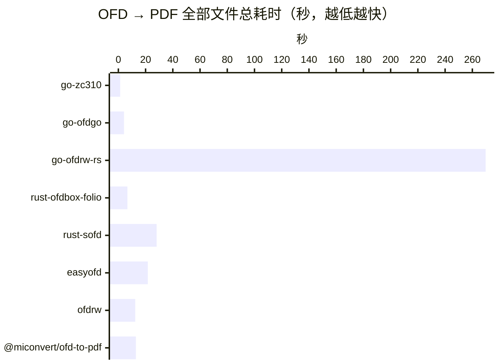

# OFD → PDF 对比测试

> [OFD 库汇总](ofd-libraries.md)：各 OFD 库能力 / 许可证对比表
>
> [PDF → OFD 对比测试](pdf-to-ofd.md)：反方向 PDF→OFD 转换对比

## 测试库

### Go 库

| 库                                                    | 版本                                  | OFD→PDF |  更新时间  | 备注                                    |
|-------------------------------------------------------|---------------------------------------|:-------:|:----------:|-----------------------------------------|
| [zc310-ofd](https://github.com/zc310/ofd)             | v0.2.3-0.20261124113956-09f1815cd2bb |   ✅    | 2026-11-14 | 已测试                                  |
| [xiaoqidun-ofdgo](https://github.com/xiaoqidun/ofdgo) | v0.0.0-20261124073143-9d9bd2ba2cde |   ✅    | 2026-11-14 | 已测试                                  |
| [ofdrw-rs Go binding](https://github.com/lihongjie0209/ofdrw-rs) | v0.5.0 | ✅ | 2026-11-15 | Go bindings + Linux 原生库，已测试 |

### Rust 库

| 库 | 版本 | OFD→PDF | 更新时间 | 备注 |
|---|---|:---:|:---:|---|
| [ofdbox-folio](https://github.com/ofdbox/ofdbox-folio) | `36e6877` | ✅ | 2026-11-16 | 通过 fontconfig 动态定位字体，已接入测试 |
| [sOFD](https://github.com/emfox/sOFD) | `65cff46` | ✅ | 2026-11-16 | Rust CLI；font-kit/fontconfig；缺字警告时保留 PDF 供视觉评测 |

### Python 库

| 库                                            | 版本     | OFD→PDF |  更新时间  | 备注                       |
|-----------------------------------------------|----------|:-------:|:----------:|----------------------------|
| [easyofd](https://pypi.org/project/easyofd/)  | 20260427 |   ⚠️    | 2026-04-27 | 部分文件失败               |

### Java 库

| 库                                      | 版本  | OFD→PDF | 更新时间   | 备注                     |
|-----------------------------------------|-------|:-------:|------------|--------------------------|
| [ofdrw](https://github.com/ofdrw/ofdrw) | 2.5.2 |   ✅    | 2026-11-14 | 需手动下载依赖，全部成功 |

### JavaScript 库

| 库                                                                           | 版本  | OFD→PDF |  更新时间  | 备注     |
|------------------------------------------------------------------------------|-------|:-------:|:----------:|----------|
| [@miconvert/ofd-to-pdf](https://www.npmjs.com/package/@miconvert/ofd-to-pdf) | 0.2.3 |   ✅    | 2026-08-03 | 全部成功 |

## 测试环境

<!-- benchmark-environment:start -->

- 系统：Ubuntu 24.04.5 LTS (x86_64)
- CPU：AMD EPYC 7763 64-Core Processor（4 逻辑核心）
- 内存：15.6 GiB
<!-- benchmark-environment:end -->
- 系统已安装 `apt-get install fonts-wqy-zenhei fonts-noto-cjk`
- 测试前运行 `bash tools/install-fonts.sh`，下载 `doc-foundertype.zip`、`doc-zhongyi-etc.zip`、`latin-fonts.zip` 并安装到用户目录 `~/.local/share/fonts/hanzi-fonts/`，随后刷新字体缓存。字体下载链接与依赖安装命令见 [README：快速开始](../README.md#快速开始)；GitHub Actions 已加入此准备步骤。

> 所有转换器均由 GitHub Actions 在上述环境统一评测。转换耗时、文件大小、文本提取及像素比较分别记录。

## 测试文件

测试用 OFD 文件来自：https://github.com/zc310/ofd-fixtures

| 文件           | 大小 | 说明         |
|----------------|------|--------------|
| hello.ofd      | 1.50K | 简单测试文件 |
| ano.ofd        | 702.00K | 带签章文件   |
| intro.ofd      | 7.20M | 介绍文档     |
| 1000-pages.ofd | 508.00K | 1000页文件   |
| 999.ofd        | 30.00K  | 带签章文件   |
| zsbk.ofd       | 1.50M | 数科签章文件 |

> `testdata/suwell/` 下的 `*.pdf` 为各 OFD 的参考转换结果，由**数科版式阅读器**导出，用作像素级对比基准。

## 测试结果

### 转换速度

图表按库累加下方速度表中全部文件的耗时，单位为秒；耗时为单次测量，多页文件可能主导总耗时。未完成全部文件的库不绘制柱形。

<!-- benchmark-charts:ofd:start -->


<!-- benchmark-charts:ofd:end -->

<!-- benchmark-table:ofd-speed:start -->

| 转换器 | hello.ofd | ano.ofd | intro.ofd | 1000-pages.ofd | 999.ofd | zsbk.ofd | 胜出次数 |
|---|---:|---:|---:|---:|---:|---:|---:|
| [go-zc310](https://github.com/zc310/ofd) | 117ms | 212ms | **489ms** | 341ms | **256ms** | 431ms | 2 |
| [go-ofdgo](https://github.com/xiaoqidun/ofdgo) | 241ms | 494ms | 514ms | **258ms** | 793ms | 729ms | 1 |
| [go-ofdrw-rs](https://github.com/lihongjie0209/ofdrw-rs) | **35ms** | 1.07s | 4.21s | 411.29s | 795ms | 858ms | 1 |
| [rust-ofdbox-folio](https://github.com/ofdbox/ofdbox-folio) | 160ms | **196ms** | 614ms | 6.95s | 447ms | **396ms** | 2 |
| [rust-sofd](https://github.com/emfox/sOFD) | 60ms | 432ms | 3.35s | 26.73s | 372ms | 3.55s | 0 |
| [easyofd](https://pypi.org/project/easyofd/) | 1.68s | 1.50s | 13.69s | 2.54s | 1.44s | 7.87s | 0 |
| [ofdrw](https://github.com/ofdrw/ofdrw) | 2.03s | 1.81s | 4.81s | 5.02s | 3.49s | 2.78s | 0 |
| [@miconvert/ofd-to-pdf](https://www.npmjs.com/package/@miconvert/ofd-to-pdf) | 353ms | 911ms | 2.22s | 13.61s | 684ms | 1.37s | 0 |
<!-- benchmark-table:ofd-speed:end -->

### CPU 总时间

CPU 总时间为进程用户态与内核态时间之和，累加所有线程及已等待回收的子进程；包含启动和包装脚本开销。多核并行时可超过墙钟时间。历史数据未采集此指标，FAILED 表示尚未采集或转换失败，需重新运行基准。

<!-- benchmark-table:ofd-cpu:start -->

| 转换器 | hello.ofd | ano.ofd | intro.ofd | 1000-pages.ofd | 999.ofd | zsbk.ofd | 胜出次数 |
|---|---:|---:|---:|---:|---:|---:|---:|
| [go-zc310](https://github.com/zc310/ofd) | 142ms | 229ms | **565ms** | **385ms** | **299ms** | 498ms | 3 |
| [go-ofdgo](https://github.com/xiaoqidun/ofdgo) | 273ms | 653ms | 1.67s | 794ms | 1.70s | 870ms | 0 |
| [go-ofdrw-rs](https://github.com/lihongjie0209/ofdrw-rs) | **25ms** | 1.06s | 4.23s | 411.09s | 792ms | 858ms | 1 |
| [rust-ofdbox-folio](https://github.com/ofdbox/ofdbox-folio) | 154ms | **196ms** | 614ms | 6.95s | 447ms | **396ms** | 2 |
| [rust-sofd](https://github.com/emfox/sOFD) | 61ms | 432ms | 3.35s | 26.72s | 373ms | 3.55s | 0 |
| [easyofd](https://pypi.org/project/easyofd/) | 1.31s | 1.50s | 13.69s | 2.54s | 1.44s | 7.87s | 0 |
| [ofdrw](https://github.com/ofdrw/ofdrw) | 2.72s | 5.06s | 11.73s | 14.83s | 6.57s | 7.95s | 0 |
| [@miconvert/ofd-to-pdf](https://www.npmjs.com/package/@miconvert/ofd-to-pdf) | 586ms | 1.85s | 3.75s | 18.97s | 1.31s | 2.42s | 0 |
<!-- benchmark-table:ofd-cpu:end -->

### 进程树内存峰值

Linux 下每 10ms 采样转换进程及其存活子孙进程的 RSS（驻留物理内存）之和，取采样峰值，包含包装脚本和运行时；MB 为 100 万字节。共享内存会重复计数，不等于实际独占物理内存；短于采样间隔的峰值、采样期间退出或脱离进程树的进程可能遗漏，读取受限也可能低估。采样带来少量额外开销。历史数据或未采到有效 RSS 显示为 FAILED，需重新运行基准。

<!-- benchmark-table:ofd-memory:start -->

| 转换器 | hello.ofd | ano.ofd | intro.ofd | 1000-pages.ofd | 999.ofd | zsbk.ofd | 胜出次数 |
|---|---:|---:|---:|---:|---:|---:|---:|
| [go-zc310](https://github.com/zc310/ofd) | 81.28MB | 143.93MB | 140.02MB | **30.69MB** | 182.42MB | 158.22MB | 1 |
| [go-ofdgo](https://github.com/xiaoqidun/ofdgo) | 135.33MB | 313.29MB | 142.73MB | 50.70MB | 798.02MB | 286.56MB | 0 |
| [go-ofdrw-rs](https://github.com/lihongjie0209/ofdrw-rs) | 37.66MB | 57.00MB | 98.10MB | 179.38MB | 65.11MB | 123.93MB | 0 |
| [rust-ofdbox-folio](https://github.com/ofdbox/ofdbox-folio) | 35.98MB | 38.30MB | **65.69MB** | 239.06MB | 68.55MB | **45.83MB** | 2 |
| [rust-sofd](https://github.com/emfox/sOFD) | **30.43MB** | **16.04MB** | 115.84MB | 345.96MB | **56.27MB** | 143.61MB | 3 |
| [easyofd](https://pypi.org/project/easyofd/) | 226.35MB | 232.33MB | 377.68MB | 232.86MB | 226.30MB | 372.04MB | 0 |
| [ofdrw](https://github.com/ofdrw/ofdrw) | 139.58MB | 307.24MB | 700.30MB | 465.95MB | 380.06MB | 449.28MB | 0 |
| [@miconvert/ofd-to-pdf](https://www.npmjs.com/package/@miconvert/ofd-to-pdf) | 93.77MB | 147.96MB | 264.62MB | 1083.35MB | 130.64MB | 185.52MB | 0 |
<!-- benchmark-table:ofd-memory:end -->

> - `python-easyofd`: `pip install easyofd`，仅使用 easyofd，不再回退到 ofd2img
> - `java-ofdrw`: `org.ofdrw:ofdrw-converter:2.5.2`
> - `node-ofd2pdf`: `npm install @miconvert/ofd-to-pdf`，优先使用 CJS 入口，失败后回退 ESM 入口
> - `rust-ofdbox-folio`: 固定 Git revision `36e6877`；字体由 `fc-match` 按系统 fontconfig 配置解析，不依赖特定用户目录
> - `rust-sofd`: 固定 Git revision `65cff46`；字体由 font-kit/fontconfig 从系统配置解析；缺字警告时 CLI 返回非零，但包装器保留有效 PDF 继续视觉评测
>
> 各转换器的成功或失败情况以本轮结果表为准。

### PDF 文件大小

<!-- benchmark-table:ofd-pdf-size:start -->

| 转换器 | hello.ofd | ano.ofd | intro.ofd | 1000-pages.ofd | 999.ofd | zsbk.ofd | 胜出次数 |
|---|---:|---:|---:|---:|---:|---:|---:|
| [go-zc310](https://github.com/zc310/ofd) | 10.02KB | 90.54KB | 7.46MB | 683.92KB | 81.90KB | 1.44MB | 0 |
| [go-ofdgo](https://github.com/xiaoqidun/ofdgo) | 4.88KB | 56.10KB | 7.56MB | **295.68KB** | **63.11KB** | 1.53MB | 2 |
| [go-ofdrw-rs](https://github.com/lihongjie0209/ofdrw-rs) | 5.41KB | 682.85KB | 9.54MB | 25.81MB | 208.70KB | 2.66MB | 0 |
| [rust-ofdbox-folio](https://github.com/ofdbox/ofdbox-folio) | 81.64KB | 258.43KB | 9.03MB | 32.78MB | 602.89KB | 1.90MB | 0 |
| [rust-sofd](https://github.com/emfox/sOFD) | 4.45KB | 971.23KB | 31.44MB | 88.40MB | 834.72KB | 15.91MB | 0 |
| [easyofd](https://pypi.org/project/easyofd/) | 23.58KB | **36.06KB** | 38.22MB | 714.14KB | 73.14KB | 13.55MB | 1 |
| [ofdrw](https://github.com/ofdrw/ofdrw) | 767.34KB | 2.39MB | 10.87MB | 2.00MB | 1.85MB | 4.98MB | 0 |
| [@miconvert/ofd-to-pdf](https://www.npmjs.com/package/@miconvert/ofd-to-pdf) | **1.64KB** | 196.51KB | **1.08MB** | 9.18MB | 82.92KB | **559.27KB** | 3 |
<!-- benchmark-table:ofd-pdf-size:end -->

### 提取文本字符数

<!-- benchmark-table:ofd-text-extraction:start -->

| 转换器 | hello.ofd | ano.ofd | intro.ofd | 1000-pages.ofd | 999.ofd | zsbk.ofd | 胜出次数 |
|---|---:|---:|---:|---:|---:|---:|---:|
| [go-zc310](https://github.com/zc310/ofd) | 22 | 7232 | 5544 | 242999 | 3971 | 1162 | 0 |
| [go-ofdgo](https://github.com/xiaoqidun/ofdgo) | 22 | 7091 | 5543 | 242999 | 3971 | 1150 | 0 |
| [go-ofdrw-rs](https://github.com/lihongjie0209/ofdrw-rs) | 22 | 7093 | 5494 | 242999 | 3934 | 1150 | 0 |
| [rust-ofdbox-folio](https://github.com/ofdbox/ofdbox-folio) | 8 | 6497 | 1959 | 129999 | 773 | 717 | 0 |
| [rust-sofd](https://github.com/emfox/sOFD) | 0 | 0 | 0 | 0 | 0 | 0 | 0 |
| [easyofd](https://pypi.org/project/easyofd/) | 22 | 1208 | **10194** | 20223 | 3933 | 1508 | 1 |
| [ofdrw](https://github.com/ofdrw/ofdrw) | 26 | **7282** | 5550 | 242999 | 4162 | 1169 | 1 |
| [@miconvert/ofd-to-pdf](https://www.npmjs.com/package/@miconvert/ofd-to-pdf) | **31** | 6489 | 9614 | **325999** | **4249** | **1938** | 4 |
<!-- benchmark-table:ofd-text-extraction:end -->

> - 单位为字符数（chars）
> - 本轮使用 PyMuPDF 1.26.7 与 NumPy 2.3.5；表格数值为本轮测试结果
> - `FAILED` 表示暂无有效结果；`1000-pages` 的字符数由 CI 对完整文档提取后更新，不使用像素比较的前 3 页采样。

### 与数科版式输出对比

以数科版式阅读器导出的 `http://github.com/zc310/ofd-fixtures/tree/main/testdata/suwell` 为基准，对比转换效果。

**全页像素相似度**（96 DPI，1 - 平均归一化色差，100% 为完全相同；白底可能稀释内容差异）：

<!-- benchmark-table:ofd-pixel-similarity:start -->

| 转换器                                                                       |    hello.ofd |      ano.ofd |    intro.ofd | 1000-pages.ofd |      999.ofd |     zsbk.ofd | 胜出次数 |
| ---------------------------------------------------------------------------- | -----------: | -----------: | -----------: | -------------: | -----------: | -----------: | -------: |
| [go-zc310](https://github.com/zc310/ofd)                                     | **99.6256%** |     99.6994% | **99.9274%** |       99.4696% |     98.5516% | **99.5087%** |        3 |
| [go-ofdgo](https://github.com/xiaoqidun/ofdgo)                               |     99.6245% | **99.7132%** |     99.9034% |       99.4735% |     98.5585% |     99.3674% |        1 |
| [go-ofdrw-rs](https://github.com/lihongjie0209/ofdrw-rs)                     |     99.6042% |     99.3757% |     99.5443% |       98.3022% |     98.5549% |     99.3803% |        0 |
| [rust-ofdbox-folio](https://github.com/ofdbox/ofdbox-folio)                  |     99.6143% |     98.8871% |     99.4565% |       99.5158% |     98.4776% |     97.4610% |        0 |
| [rust-sofd](https://github.com/emfox/sOFD)                                   |     99.3777% |       FAILED |       FAILED |       99.4495% | **98.5894%** |     97.8387% |        1 |
| [easyofd](https://pypi.org/project/easyofd/)                                 |       FAILED |       FAILED |       FAILED |         FAILED |       FAILED |       FAILED |        0 |
| [ofdrw](https://github.com/ofdrw/ofdrw)                                      |     99.3014% |     99.5336% |     99.2697% |   **99.7592%** |     97.3310% |     99.0643% |        1 |
| [@miconvert/ofd-to-pdf](https://www.npmjs.com/package/@miconvert/ofd-to-pdf) |     99.0101% |     97.5476% |     96.3040% |       97.5646% |     95.8150% |     94.3882% |        0 |
<!-- benchmark-table:ofd-pixel-similarity:end -->

**SSIM 结构相似度**（96 DPI）：原尺寸 RGB 三通道分别计算 7×7 均匀窗口 SSIM，使用样本协方差、`K1=0.01`、`K2=0.03`、`data_range=255`；对有效窗口及通道取平均，负分截为 0 后乘 100%，再对页面等权平均。不缩放、不平移，图片至少为 7×7 像素。白底仍可能抬高 SSIM，应结合内容相似度及前景 F1 阅读。新增指标，尚未统一重测的单元格记为 `FAILED`，不将旧像素分数当作 SSIM。

<!-- benchmark-table:ofd-ssim:start -->

| 转换器                                                                       |    hello.ofd |      ano.ofd |    intro.ofd | 1000-pages.ofd |      999.ofd |     zsbk.ofd | 胜出次数 |
| ---------------------------------------------------------------------------- | -----------: | -----------: | -----------: | -------------: | -----------: | -----------: | -------: |
| [go-zc310](https://github.com/zc310/ofd)                                     |     98.4147% |     96.4019% | **99.9215%** |       98.9348% |     94.6068% | **98.2789%** |        2 |
| [go-ofdgo](https://github.com/xiaoqidun/ofdgo)                               |     98.4153% | **96.5059%** |     99.7908% |       98.9368% |     94.6339% |     97.9220% |        1 |
| [go-ofdrw-rs](https://github.com/lihongjie0209/ofdrw-rs)                     |     98.4519% |     94.7385% |     98.2948% |       94.0125% |     94.5802% |     97.9597% |        0 |
| [rust-ofdbox-folio](https://github.com/ofdbox/ofdbox-folio)                  | **98.5058%** |     91.9001% |     97.6073% |       99.2554% |     94.1465% |     92.1541% |        1 |
| [rust-sofd](https://github.com/emfox/sOFD)                                   |     98.0371% |       FAILED |       FAILED |       98.9422% | **95.7427%** |     81.2495% |        1 |
| [easyofd](https://pypi.org/project/easyofd/)                                 |       FAILED |       FAILED |       FAILED |         FAILED |       FAILED |       FAILED |        0 |
| [ofdrw](https://github.com/ofdrw/ofdrw)                                      |     97.6776% |     92.2887% |     96.4110% |   **99.7294%** |     88.8908% |     96.0038% |        1 |
| [@miconvert/ofd-to-pdf](https://www.npmjs.com/package/@miconvert/ofd-to-pdf) |     96.6270% |     73.1689% |     89.2050% |       90.1236% |     73.7348% |     79.3245% |        0 |
<!-- benchmark-table:ofd-ssim:end -->

**内容区域像素相似度**（96 DPI）：RGB 任一通道低于 250 视为非白内容。参考内容处的颜色误差与参考内容外的额外输出误差相加，仅除以参考非白像素数；分数为 `max(0, 1 - 归一化误差) × 100%`。不扩边、不裁剪，不允许输出扩大掩码分母稀释误差。双方空白页不参与内容分数平均，全空白文档无内容分数（记 `FAILED`）。此指标有方向性，始终以数科输出为参考；与旧并集扩边分数不可混用。

<!-- benchmark-table:ofd-content-similarity:start -->

| 转换器                                                                       |    hello.ofd |      ano.ofd |    intro.ofd | 1000-pages.ofd |      999.ofd |     zsbk.ofd | 胜出次数 |
| ---------------------------------------------------------------------------- | -----------: | -----------: | -----------: | -------------: | -----------: | -----------: | -------: |
| [go-zc310](https://github.com/zc310/ofd)                                     | **67.0756%** |     96.5414% | **99.8775%** |       99.3933% |     80.5185% | **99.4135%** |        3 |
| [go-ofdgo](https://github.com/xiaoqidun/ofdgo)                               |     67.0214% | **96.7360%** |     99.8320% |       99.3978% |     80.6344% |     99.2447% |        1 |
| [go-ofdrw-rs](https://github.com/lihongjie0209/ofdrw-rs)                     |     65.1940% |     91.2024% |     99.0482% |       98.0531% |     80.5826% |     99.2600% |        0 |
| [rust-ofdbox-folio](https://github.com/ofdbox/ofdbox-folio)                  |     66.0797% |     83.1038% |     97.8565% |       99.4459% |     79.6476% |     96.9594% |        0 |
| [rust-sofd](https://github.com/emfox/sOFD)                                   |     45.2732% |       FAILED |       FAILED |       99.3700% | **81.5085%** |     97.4231% |        1 |
| [easyofd](https://pypi.org/project/easyofd/)                                 |       FAILED |       FAILED |       FAILED |         FAILED |       FAILED |       FAILED |        0 |
| [ofdrw](https://github.com/ofdrw/ofdrw)                                      |     38.5537% |     94.9182% |     98.7727% |   **99.7238%** |     64.4916% |     98.8841% |        1 |
| [@miconvert/ofd-to-pdf](https://www.npmjs.com/package/@miconvert/ofd-to-pdf) |     12.9386% |     62.6689% |     91.9556% |       97.2061% |     43.5136% |     93.3086% |        0 |
<!-- benchmark-table:ofd-content-similarity:end -->

**前景覆盖 F1**：独立衡量形状覆盖，允许约 0.265 mm 的邻域距离（96 DPI 时为 1 像素），兼顾漏画召回率与多画精确率，不替代颜色误差。双方空白页不参与平均。

<!-- benchmark-table:ofd-foreground-f1:start -->

| 转换器                                                                       |    hello.ofd |      ano.ofd |    intro.ofd | 1000-pages.ofd |      999.ofd |      zsbk.ofd | 胜出次数 |
| ---------------------------------------------------------------------------- | -----------: | -----------: | -----------: | -------------: | -----------: | ------------: | -------: |
| [go-zc310](https://github.com/zc310/ofd)                                     |     86.4575% |     98.2966% | **99.9999%** |       99.9795% |     98.0859% | **100.0000%** |        2 |
| [go-ofdgo](https://github.com/xiaoqidun/ofdgo)                               | **86.5082%** | **98.3852%** |     99.9993% |       99.9795% |     98.0979% | **100.0000%** |        2 |
| [go-ofdrw-rs](https://github.com/lihongjie0209/ofdrw-rs)                     |     82.3523% |     98.3392% |     99.4960% |       99.6211% |     98.0956% | **100.0000%** |        0 |
| [rust-ofdbox-folio](https://github.com/ofdbox/ofdbox-folio)                  |     82.6337% |     92.0558% |     99.9050% |       99.9997% |     97.5021% |      65.3361% |        0 |
| [rust-sofd](https://github.com/emfox/sOFD)                                   |     67.1358% |       FAILED |       FAILED |       99.9997% | **99.2717%** |      99.9849% |        1 |
| [easyofd](https://pypi.org/project/easyofd/)                                 |       FAILED |       FAILED |       FAILED |         FAILED |       FAILED |        FAILED |        0 |
| [ofdrw](https://github.com/ofdrw/ofdrw)                                      |     62.0661% |     73.3674% |     99.7626% |  **100.0000%** |     87.6675% |      99.9994% |        1 |
| [@miconvert/ofd-to-pdf](https://www.npmjs.com/package/@miconvert/ofd-to-pdf) |      6.0813% |      4.8266% |     92.9024% |       99.2122% |     11.4722% |      20.4144% |        0 |
<!-- benchmark-table:ofd-foreground-f1:end -->

> 页面显示尺寸相差超过 0.5 pt 时判失败；像素尺寸仅允许 1 像素舍入差异，差异部分用白色补齐。MuPDF 渲染警告或错误判为 `FAILED`，不对不完整渲染给分。
>
> `1000-pages` 因内容重复，全页像素相似度、SSIM、内容区域像素相似度及前景 F1 仅比较前 3 页，仍校验总页数一致。转换、输出大小及文本比较仍针对完整文档。

**文件大小对比**（转换后 PDF 大小 / 数科参考 PDF 大小）：

<!-- benchmark-table:ofd-size-ratio:start -->

| 转换器 | hello.ofd | ano.ofd | intro.ofd | 1000-pages.ofd | 999.ofd | zsbk.ofd |
|---|---:|---:|---:|---:|---:|---:|
| 数科版式阅读器 | 1.00 | 1.00 | 1.00 | 1.00 | 1.00 | 1.00 |
| [go-zc310](https://github.com/zc310/ofd) | 2.85 | 0.10 | 1.11 | 0.35 | 1.02 | 0.92 |
| [go-ofdgo](https://github.com/xiaoqidun/ofdgo) | 1.38 | 0.06 | 1.13 | **0.15** | **0.79** | 0.97 |
| [go-ofdrw-rs](https://github.com/lihongjie0209/ofdrw-rs) | 1.54 | 0.76 | 1.42 | 13.59 | 2.61 | 1.69 |
| [rust-ofdbox-folio](https://github.com/ofdbox/ofdbox-folio) | 23.19 | 0.29 | 1.35 | 17.26 | 7.54 | 1.21 |
| [rust-sofd](https://github.com/emfox/sOFD) | 1.26 | 1.07 | 4.69 | 46.54 | 10.44 | 10.12 |
| [easyofd](https://pypi.org/project/easyofd/) | 6.70 | **0.04** | 5.70 | 0.37 | 0.92 | 8.62 |
| [ofdrw](https://github.com/ofdrw/ofdrw) | 217.96 | 2.71 | 1.62 | 1.05 | 23.71 | 3.17 |
| [@miconvert/ofd-to-pdf](https://www.npmjs.com/package/@miconvert/ofd-to-pdf) | **0.47** | 0.22 | **0.16** | 4.83 | 1.04 | **0.35** |
<!-- benchmark-table:ofd-size-ratio:end -->

> - 仿色、抗锯齿等渲染差异会影响像素相似度
> - 若参考页有可见内容而输出页几乎全白，像素对比会标记为 `FAILED`，避免大面积白底虚高
> - intro 的像素对比跳过 14～19 页（数科导出的参考 PDF 这几页背景图丢失，不计入对比）
> - 各转换器失败情况以结果表为准；ofd2img、python-ofd2pdf 已移出评测
> - 复现命令：`python3 tools/compare_pdf.py 96 <file>`

**文本相似度**（与数科参考 PDF 提取文本的 4-gram Jaccard 相似度，100% 为文本完全一致；`0.0000%` 表示无文本或提取失败）：

参考文本长度（fitz 1.26.7 口径）：`hello=22` · `ano=7091` · `intro=5543` · `1000-pages=263999` · `999=3934` · `zsbk=1150`

<!-- benchmark-table:ofd-text-similarity:start -->

| 转换器                                                                       |     hello.ofd |       ano.ofd |    intro.ofd | 1000-pages.ofd |       999.ofd |      zsbk.ofd | 胜出次数 |
| ---------------------------------------------------------------------------- | ------------: | ------------: | -----------: | -------------: | ------------: | ------------: | -------: |
| [go-zc310](https://github.com/zc310/ofd)                                     | **100.0000%** |      99.0642% | **99.7108%** |  **100.0000%** |      95.8466% |      98.8550% |        2 |
| [go-ofdgo](https://github.com/xiaoqidun/ofdgo)                               | **100.0000%** | **100.0000%** |     99.5998% |  **100.0000%** |      95.8466% | **100.0000%** |        2 |
| [go-ofdrw-rs](https://github.com/lihongjie0209/ofdrw-rs)                     | **100.0000%** |      99.7326% |     94.8774% |  **100.0000%** | **100.0000%** | **100.0000%** |        1 |
| [rust-ofdbox-folio](https://github.com/ofdbox/ofdbox-folio)                  |      26.3158% |      18.0425% |      3.6655% |        3.9886% |      39.6495% |       0.0000% |        0 |
| [rust-sofd](https://github.com/emfox/sOFD)                                   |       0.0000% |       0.0000% |      0.0000% |        0.0000% |       0.0000% |       0.0000% |        0 |
| [easyofd](https://pypi.org/project/easyofd/)                                 | **100.0000%** |      12.5671% |      0.0613% |       98.3760% |      80.5362% |      11.1995% |        0 |
| [ofdrw](https://github.com/ofdrw/ofdrw)                                      |      17.1429% |      70.5815% |     38.2801% |  **100.0000%** |      56.7814% |      64.7194% |        1 |
| [@miconvert/ofd-to-pdf](https://www.npmjs.com/package/@miconvert/ofd-to-pdf) |      10.8108% |      97.3262% |      5.8607% |       83.3078% |      41.2362% |       4.8555% |        0 |
<!-- benchmark-table:ofd-text-similarity:end -->

> - 复现命令：`python3 tools/compare_text.py <file>`

## 使用方法

```bash
# 编译
go build -o bin/ofd-benchmark .
go build -o bin/ofdgo-convert ./cmd/ofdgo-convert
go build -o bin/zc310-convert ./cmd/zc310-convert
cargo build --release --locked --manifest-path rust/ofdbox-folio-convert/Cargo.toml --target-dir rust/target
cp rust/target/release/ofdbox-folio-convert bin/ofdbox-folio-convert
cargo install sofd-cli --git https://github.com/emfox/sOFD --rev 65cff468ecc2af676180f540899fdf74da849c3a --locked --bin sofd --root /tmp/sofd-install
cp /tmp/sofd-install/bin/sofd bin/sofd-cli

# 安装 Python 依赖
python -m pip install --only-binary=:all: --require-hashes -r python/requirements.txt

# 编译 Java 转换器（需要先下载依赖，见 java/README.md）
cd java && javac -cp "$(ls lib/*.jar | tr '\n' ':')" Ofd2Pdf.java && cd ..

# 安装 Node.js 依赖
cd node && npm ci && cd ..

# 运行测试（默认测试所有转换器）
./bin/ofd-benchmark <file.ofd>

# 只测试某个转换器
./bin/ofd-benchmark <file.ofd> ofdgo
./bin/ofd-benchmark <file.ofd> zc310
./bin/ofd-benchmark <file.ofd> python
./bin/ofd-benchmark <file.ofd> ofdbox-folio
./bin/ofd-benchmark <file.ofd> sofd
./bin/ofd-benchmark <file.ofd> java
./bin/ofd-benchmark <file.ofd> node
```

转换后的 PDF 文件保存在 `bin/output/` 目录，命名格式：`{原文件名}_{转换器}.pdf`

转换器名称：

- `go-ofdgo`
- `go-zc310`
- `rust-ofdbox-folio`
- `rust-sofd`
- `python-easyofd`
- `java-ofdrw`
- `node-ofd2pdf`

## 项目结构

```
ofd-benchmark/
├── bin/
│   ├── ofd-benchmark       # 主程序
│   ├── ofdgo-convert       # Go 转换器
│   ├── zc310-convert       # Go 转换器
│   └── output/             # 转换后的 PDF 文件
├── python/
│   ├── ofd2pdf.py          # Python 转换器（仅 easyofd）
│   └── ofd2pdf_ofd2pdf.py  # 旧独立脚本，仅供参考，不参与评测
├── java/
│   ├── Ofd2Pdf.java        # Java 转换器（ofdrw）
│   ├── ofd2pdf_java.sh     # Java 启动脚本
│   ├── lib/                # JAR 依赖
│   └── README.md           # 依赖下载说明
├── node/
│   ├── ofd2pdf.mjs         # Node.js 转换器（@miconvert/ofd-to-pdf）
│   ├── ofd2pdf_node.sh     # Node.js 启动脚本
│   └── package.json
├── cmd/
│   ├── ofdgo-convert/
│   └── zc310-convert/
├── main.go
├── go.mod
└── README.md
```
