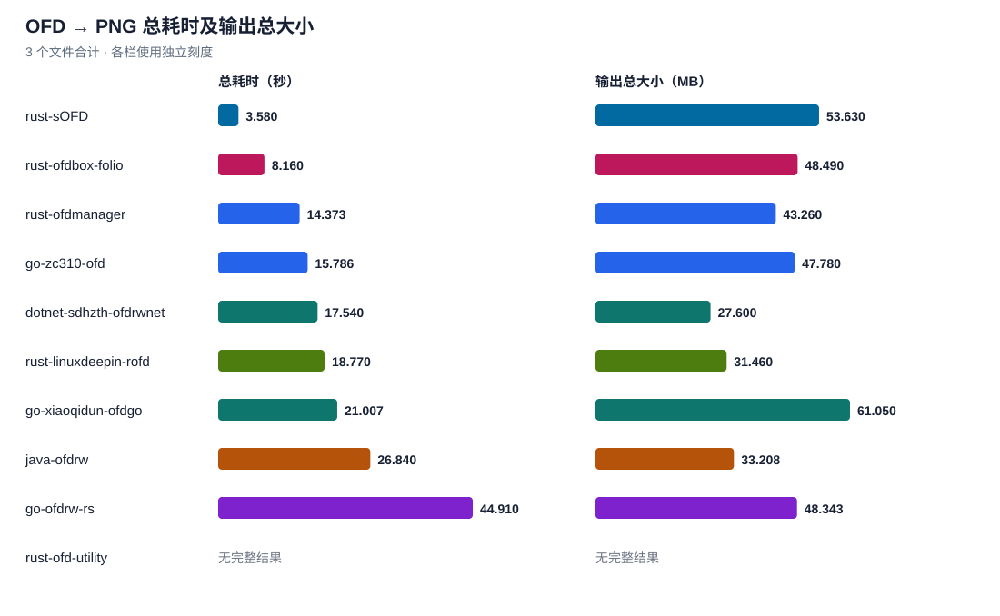

# OFD → PNG 基准测试（200 DPI）

仅对比可原生指定 **200 DPI** 的 OFD→PNG 渲染，不使用 PDF 中转，不放大低分辨率图片。参考图为数科版式阅读器从 OFD **直接导出的 200 DPI PNG**，位于 `testdata/suwell/<name>/<name>_<页码>.png`。

当前样本：`999`（5 页）、`intro`（42 页）、`zsbk`（2 页）。测试全部页面，包含 `intro` 第 14～19 页；不继承 PDF 评测的缺背景页排除规则。

## 转换器

| 转换器 | 版本 | 路径 |
|---|---|---|
| [go-zc310-ofd](https://github.com/zc310/ofd) | v0.2.3-0.20261124113956-09f1815cd2bb | `converter.Image`，PNG / 200 DPI / 白底 |
| [go-xiaoqidun-ofdgo](https://github.com/xiaoqidun/ofdgo) | v0.0.0-20261124073143-9d9bd2ba2cde | `RenderToPNG`，200 DPI / 包含注释 |
| [rust-ofd-utility](https://github.com/ofd-utility/ofd-utility) | d603791e933a81936b23c91dcab90fdc4c2c0edf | `ofd-cli render --dpi 200 --format png`（200 DPI） |
| [go-ofdrw-rs](https://github.com/lihongjie0209/ofdrw-rs) | v0.5.0 | 原生 `PagePNG(index, 200)`（200 DPI） |
| [rust-ofdbox-folio](https://github.com/ofdbox/ofdbox-folio) | 36e6877bf5d0b989cd824c3c74241533ae1f90ea | 原生 CPU 渲染，200 DPI |
| [rust-sOFD](https://github.com/emfox/sOFD) | 65cff468ecc2af676180f540899fdf74da849c3a | 原生 CLI `convert --format png --dpi 200` |
| [java-ofdrw](https://github.com/ofdrw/ofdrw) | 2.5.2 | 原生 AWT `ImageMaker(reader, 200.0 / 25.4)`（200 DPI） |
| [rust-ofdmanager](https://github.com/feuvan/ofdmanager) | a9b1d29ef90141a369ad47cc32fd6c62dd8b8450 | 原生 CLI `render --dpi 200 --page n`（200 DPI） |
| [rust-linuxdeepin-rofd](https://github.com/linuxdeepin/rofd) | af6d562a649df85487e91b88375894a6049ad4de | `rofd-render` Cairo 原生渲染，200 DPI / 白底 |
| [dotnet-sdhzth-ofdrwnet](https://github.com/sdhzth/ofdrwnet) | 85b47e1c3c8c244236658ea3914e421bc2b25c66 | `OfdImageMaker` Skia 原生渲染，200 DPI / 白底 |

选择键为 `zc310`、`ofdgo`、`ofd-utility`、`ofdrw-rs`、`ofdbox-folio`、`sofd`、`java`、`ofdmanager`、`linuxdeepin-rofd`、`sdhzth-ofdrwnet`，不指定时全部运行。

`ofd-utility` 的 Python 适配器仅传递固定参数并统一页码/文件名，不解码或重绘图片。`ofdmanager` 上游 CLI 一次只渲染一页，适配器按 OFD 中的页数循环调用，重复解析/字体加载计入耗时；多文档 OFD 会明确拒绝，不静默只测第一个文档。原生 Java `ImageMaker` 的构造参数是**像素/毫米，不是 DPI**。

sOFD 与现有 PDF 包装器保持一致：仅在返回码 1 且 stderr 完整匹配缺字警告时，保留完整 PNG 继续质量比较，让缺字反映在画质得分中；其他非零退出、缺页及损坏文件仍记失败。

linuxdeepin-rofd 使用系统字体以及 `Noto Sans CJK SC`、`Noto Sans Mono` 回退字体，逐页输出上游渲染诊断；上游签章绘制可能静默跳过无法解码的印章，因此仍须结合图片质量判断。

Python `ofd2img 0.1.2` 与 Python easyofd 的图片接口均先转 PDF，再固定以 144 DPI 渲染，故不参加本项评测；Node `@miconvert/ofd-to-pdf` 当前发布包仅有 PDF 输出接口，也不参与 PNG 比较。已有 OFD→PDF 评测保持不变。

## 评测规则

- 耗时包含进程启动、解析、渲染、PNG 编码及写盘；不含后续质量比较。毫秒/页为总耗时除以完整输出页数。PNG 总大小是所有页面文件的字节数之和，受各库默认无损压缩策略影响。
- 输出页数、连续页码必须与参考一致；图片尺寸只允许 1 像素的栅格取整差异，统一在右侧/底部补白，不缩放、不裁切、不平移。
- 比较时透明度统一合成白底并转 RGB。参考图的 DPI 元数据若存在，须在 200±1 范围内（数科导出的约 200.03 属正常取整）。
- **SSIM 结构相似度**：原尺寸 RGB 三通道分别计算 7×7 均匀窗口 SSIM（样本协方差，`K1=0.01`、`K2=0.03`、`data_range=255`），对有效窗口及通道取平均，负分截为 0 后乘 100%。各页等权平均，不缩放、不平移。SSIM 仍可能被大面积白底抬高，应结合内容相似度与前景 F1 阅读。
- **内容相似度**：沿用 PDF 评测的参考前景归一化色差，计入丢失内容和额外墨迹的误差，以参考非白像素数归一化。
- **前景 F1**：允许约 0.265 mm 的物理位置误差，在 200 DPI 对应 2 像素；仅 F1 有容差，颜色比较不移动图像。
- **全页相似度**：`1 − 平均归一化 RGB 色差`。各页等权平均；全白页不抬高内容/F1 得分。丢失几乎全部前景、损坏 PNG、缺页或尺寸不符均记为 `FAILED`。
- 单次转换默认限时 15 分钟，可通过 `BENCHMARK_CONVERTER_TIMEOUT=30m` 调整；超时终止整个进程组并清理部分输出。重跑时清除该转换器旧输出，质量得分重置，避免沿用旧结果。

## 原生 PNG 结果（10 个转换器）

表格由 `docs/benchmark-results.yaml` 生成，勿直接编辑。`FAILED` 表示尚无本轮有效测量或转换/比较失败；首次正式结果由 CI 统一环境测量，本地验证不覆盖已有 PDF 报告的运行环境。

### 图表概览

图表按库累加三个文件的耗时和输出大小；耗时为单次测量，较长的 `intro` 文件对总耗时影响较大。

<!-- benchmark-charts:png:start -->



每项仅在全部文件有有效结果时显示；缺失项标为“无完整结果”。大小按表格中的取整数值累加，MB 为 100 万字节。PNG 大小包含所有页面。文件较小不一定表示质量更好，请结合还原度等结果查看。

耗时无完整结果：`rust-ofd-utility`（intro.ofd）；`dotnet-sdhzth-ofdrwnet`（999.ofd、intro.ofd、zsbk.ofd）。

大小无完整结果：`rust-ofd-utility`（intro.ofd）；`dotnet-sdhzth-ofdrwnet`（999.ofd、intro.ofd、zsbk.ofd）。
<!-- benchmark-charts:png:end -->

### 总耗时

<!-- benchmark-table:png-speed:start -->

| 转换器 | 999.ofd | intro.ofd | zsbk.ofd | 胜出次数 |
|---|---:|---:|---:|---:|
| [go-zc310-ofd](https://github.com/zc310/ofd) | 529ms | 8.72s | 2.40s | 0 |
| [go-xiaoqidun-ofdgo](https://github.com/xiaoqidun/ofdgo) | 745ms | 12.63s | 2.17s | 0 |
| [rust-ofd-utility](https://github.com/ofd-utility/ofd-utility) | 267ms | FAILED | **108ms** | 1 |
| [go-ofdrw-rs](https://github.com/lihongjie0209/ofdrw-rs) | 6.91s | 30.38s | 5.92s | 0 |
| [rust-ofdbox-folio](https://github.com/ofdbox/ofdbox-folio) | 354ms | 5.56s | 909ms | 0 |
| [rust-linuxdeepin-rofd](https://github.com/linuxdeepin/rofd) | 744ms | 9.75s | 2.31s | 0 |
| [rust-sOFD](https://github.com/emfox/sOFD) | **201ms** | **2.10s** | 495ms | 2 |
| [java-ofdrw](https://github.com/ofdrw/ofdrw) | 1.61s | 12.29s | 4.17s | 0 |
| [rust-ofdmanager](https://github.com/feuvan/ofdmanager) | 711ms | 9.36s | 1.24s | 0 |
| [dotnet-sdhzth-ofdrwnet](https://github.com/sdhzth/ofdrwnet) | FAILED | FAILED | FAILED | 0 |
<!-- benchmark-table:png-speed:end -->

### CPU 总时间

CPU 总时间为进程用户态与内核态时间之和，累加所有线程及已等待回收的子进程；包含启动和包装脚本开销。多核并行时可超过墙钟时间。历史数据未采集此指标，FAILED 表示尚未采集或转换失败，需重新运行基准。

<!-- benchmark-table:png-cpu:start -->

| 转换器 | 999.ofd | intro.ofd | zsbk.ofd | 胜出次数 |
|---|---:|---:|---:|---:|
| [go-zc310-ofd](https://github.com/zc310/ofd) | 556ms | 8.84s | 2.48s | 0 |
| [go-xiaoqidun-ofdgo](https://github.com/xiaoqidun/ofdgo) | 781ms | 15.15s | 3.41s | 0 |
| [rust-ofd-utility](https://github.com/ofd-utility/ofd-utility) | 267ms | FAILED | **107ms** | 1 |
| [go-ofdrw-rs](https://github.com/lihongjie0209/ofdrw-rs) | 6.91s | 30.42s | 5.92s | 0 |
| [rust-ofdbox-folio](https://github.com/ofdbox/ofdbox-folio) | 354ms | 5.60s | 949ms | 0 |
| [rust-linuxdeepin-rofd](https://github.com/linuxdeepin/rofd) | 727ms | 9.75s | 2.31s | 0 |
| [rust-sOFD](https://github.com/emfox/sOFD) | **201ms** | **2.10s** | 495ms | 2 |
| [java-ofdrw](https://github.com/ofdrw/ofdrw) | 4.22s | 17.61s | 7.84s | 0 |
| [rust-ofdmanager](https://github.com/feuvan/ofdmanager) | 711ms | 9.36s | 1.24s | 0 |
| [dotnet-sdhzth-ofdrwnet](https://github.com/sdhzth/ofdrwnet) | FAILED | FAILED | FAILED | 0 |
<!-- benchmark-table:png-cpu:end -->

### 进程树内存峰值

Linux 下每 10ms 采样转换进程及其存活子孙进程的 RSS（驻留物理内存）之和，取采样峰值，包含包装脚本和运行时；MB 为 100 万字节。共享内存会重复计数，不等于实际独占物理内存；短于采样间隔的峰值、采样期间退出或脱离进程树的进程可能遗漏，读取受限也可能低估。采样带来少量额外开销。历史数据或未采到有效 RSS 显示为 FAILED，需重新运行基准。

<!-- benchmark-table:png-memory:start -->

| 转换器 | 999.ofd | intro.ofd | zsbk.ofd | 胜出次数 |
|---|---:|---:|---:|---:|
| [go-zc310-ofd](https://github.com/zc310/ofd) | 227.93MB | 225.74MB | 363.21MB | 0 |
| [go-xiaoqidun-ofdgo](https://github.com/xiaoqidun/ofdgo) | 319.90MB | 260.57MB | 451.42MB | 0 |
| [rust-ofd-utility](https://github.com/ofd-utility/ofd-utility) | **76.61MB** | FAILED | **57.07MB** | 2 |
| [go-ofdrw-rs](https://github.com/lihongjie0209/ofdrw-rs) | 80.67MB | 216.15MB | 149.91MB | 0 |
| [rust-ofdbox-folio](https://github.com/ofdbox/ofdbox-folio) | 116.90MB | 152.15MB | 218.57MB | 0 |
| [rust-linuxdeepin-rofd](https://github.com/linuxdeepin/rofd) | 223.71MB | 190.27MB | 205.09MB | 0 |
| [rust-sOFD](https://github.com/emfox/sOFD) | 97.37MB | **99.09MB** | 160.23MB | 1 |
| [java-ofdrw](https://github.com/ofdrw/ofdrw) | 400.43MB | 762.09MB | 1001.46MB | 0 |
| [rust-ofdmanager](https://github.com/feuvan/ofdmanager) | 163.44MB | 198.30MB | 300.78MB | 0 |
| [dotnet-sdhzth-ofdrwnet](https://github.com/sdhzth/ofdrwnet) | FAILED | FAILED | FAILED | 0 |
<!-- benchmark-table:png-memory:end -->

### 平均每页耗时

<!-- benchmark-table:png-ms-per-page:start -->

| 转换器 | 999.ofd | intro.ofd | zsbk.ofd | 胜出次数 |
|---|---:|---:|---:|---:|
| [go-zc310-ofd](https://github.com/zc310/ofd) | 105.74ms | 207.67ms | 1201.43ms | 0 |
| [go-xiaoqidun-ofdgo](https://github.com/xiaoqidun/ofdgo) | 149.02ms | 300.63ms | 1082.60ms | 0 |
| [rust-ofd-utility](https://github.com/ofd-utility/ofd-utility) | 53.43ms | FAILED | **53.82ms** | 1 |
| [go-ofdrw-rs](https://github.com/lihongjie0209/ofdrw-rs) | 1382.28ms | 723.37ms | 2958.08ms | 0 |
| [rust-ofdbox-folio](https://github.com/ofdbox/ofdbox-folio) | 70.73ms | 132.45ms | 454.41ms | 0 |
| [rust-linuxdeepin-rofd](https://github.com/linuxdeepin/rofd) | 148.83ms | 232.15ms | 1153.22ms | 0 |
| [rust-sOFD](https://github.com/emfox/sOFD) | **40.18ms** | **50.09ms** | 247.47ms | 2 |
| [java-ofdrw](https://github.com/ofdrw/ofdrw) | 322.79ms | 292.55ms | 2082.79ms | 0 |
| [rust-ofdmanager](https://github.com/feuvan/ofdmanager) | 142.25ms | 222.78ms | 617.67ms | 0 |
| [dotnet-sdhzth-ofdrwnet](https://github.com/sdhzth/ofdrwnet) | FAILED | FAILED | FAILED | 0 |
<!-- benchmark-table:png-ms-per-page:end -->

### PNG 总大小

<!-- benchmark-table:png-size:start -->

| 转换器 | 999.ofd | intro.ofd | zsbk.ofd | 胜出次数 |
|---|---:|---:|---:|---:|
| [go-zc310-ofd](https://github.com/zc310/ofd) | 1.64MB | 39.37MB | 6.77MB | 0 |
| [go-xiaoqidun-ofdgo](https://github.com/xiaoqidun/ofdgo) | 1.69MB | 50.81MB | 8.55MB | 0 |
| [rust-ofd-utility](https://github.com/ofd-utility/ofd-utility) | 2.36MB | FAILED | **335.15KB** | 1 |
| [go-ofdrw-rs](https://github.com/lihongjie0209/ofdrw-rs) | 972.55KB | 40.02MB | 7.35MB | 0 |
| [rust-ofdbox-folio](https://github.com/ofdbox/ofdbox-folio) | 1.41MB | 43.16MB | 3.92MB | 0 |
| [rust-linuxdeepin-rofd](https://github.com/linuxdeepin/rofd) | 1.85MB | **22.28MB** | 7.33MB | 1 |
| [rust-sOFD](https://github.com/emfox/sOFD) | 2.40MB | 42.10MB | 9.13MB | 0 |
| [java-ofdrw](https://github.com/ofdrw/ofdrw) | **567.95KB** | 25.65MB | 6.99MB | 1 |
| [rust-ofdmanager](https://github.com/feuvan/ofdmanager) | 2.39MB | 31.92MB | 8.95MB | 0 |
| [dotnet-sdhzth-ofdrwnet](https://github.com/sdhzth/ofdrwnet) | FAILED | FAILED | FAILED | 0 |
<!-- benchmark-table:png-size:end -->

### SSIM 结构相似度

新增指标，尚未统一重测的单元格记为 `FAILED`；原有像素分数不改名、不混用。

<!-- benchmark-table:png-ssim:start -->

| 转换器                                                         |      999.ofd |    intro.ofd |     zsbk.ofd | 胜出次数 |
| -------------------------------------------------------------- | -----------: | -----------: | -----------: | -------: |
| [go-zc310-ofd](https://github.com/zc310/ofd)                   |     96.3484% | **98.6019%** | **92.2669%** |        2 |
| [go-xiaoqidun-ofdgo](https://github.com/xiaoqidun/ofdgo)       |     96.2519% |     98.4969% |     91.6620% |        0 |
| [rust-ofd-utility](https://github.com/ofd-utility/ofd-utility) |     96.6870% |       FAILED |       FAILED |        0 |
| [go-ofdrw-rs](https://github.com/lihongjie0209/ofdrw-rs)       |     96.8824% |     97.1827% |     89.5420% |        0 |
| [rust-ofdbox-folio](https://github.com/ofdbox/ofdbox-folio)    |     96.7114% |     95.7257% |     84.3126% |        0 |
| [rust-linuxdeepin-rofd](https://github.com/linuxdeepin/rofd)   |     96.8055% |     85.1589% |     90.9853% |        0 |
| [rust-sOFD](https://github.com/emfox/sOFD)                     |     91.4255% |     94.7092% |     90.0743% |        0 |
| [java-ofdrw](https://github.com/ofdrw/ofdrw)                   |     95.3582% |     85.6372% |     91.0660% |        0 |
| [rust-ofdmanager](https://github.com/feuvan/ofdmanager)        | **96.9060%** |       FAILED |     90.4407% |        1 |
| [dotnet-sdhzth-ofdrwnet](https://github.com/sdhzth/ofdrwnet)   |       FAILED |       FAILED |       FAILED |        0 |
<!-- benchmark-table:png-ssim:end -->

### 内容相似度

<!-- benchmark-table:png-content-similarity:start -->

| 转换器                                                         |      999.ofd |    intro.ofd |     zsbk.ofd | 胜出次数 |
| -------------------------------------------------------------- | -----------: | -----------: | -----------: | -------: |
| [go-zc310-ofd](https://github.com/zc310/ofd)                   |     66.4830% | **99.1257%** |     97.8587% |        1 |
| [go-xiaoqidun-ofdgo](https://github.com/xiaoqidun/ofdgo)       |     67.4442% |     99.0936% |     97.8820% |        0 |
| [rust-ofd-utility](https://github.com/ofd-utility/ofd-utility) |     68.5766% |       FAILED |       FAILED |        0 |
| [go-ofdrw-rs](https://github.com/lihongjie0209/ofdrw-rs)       |     69.6528% |     98.3647% |     97.7372% |        0 |
| [rust-ofdbox-folio](https://github.com/ofdbox/ofdbox-folio)    |     68.8659% |     95.0080% |     95.5662% |        0 |
| [rust-linuxdeepin-rofd](https://github.com/linuxdeepin/rofd)   | **70.2348%** |     94.7796% |     97.8967% |        1 |
| [rust-sOFD](https://github.com/emfox/sOFD)                     |     26.7512% |     96.0890% |     97.4508% |        0 |
| [java-ofdrw](https://github.com/ofdrw/ofdrw)                   |     58.5568% |     94.5649% | **97.9273%** |        1 |
| [rust-ofdmanager](https://github.com/feuvan/ofdmanager)        |     69.7961% |       FAILED |     97.8081% |        0 |
| [dotnet-sdhzth-ofdrwnet](https://github.com/sdhzth/ofdrwnet)   |       FAILED |       FAILED |       FAILED |        0 |
<!-- benchmark-table:png-content-similarity:end -->

### 前景 F1

<!-- benchmark-table:png-foreground-f1:start -->

| 转换器                                                         |       999.ofd |    intro.ofd |      zsbk.ofd | 胜出次数 |
| -------------------------------------------------------------- | ------------: | -----------: | ------------: | -------: |
| [go-zc310-ofd](https://github.com/zc310/ofd)                   | **100.0000%** |     99.9950% | **100.0000%** |        2 |
| [go-xiaoqidun-ofdgo](https://github.com/xiaoqidun/ofdgo)       | **100.0000%** | **99.9970%** | **100.0000%** |        1 |
| [rust-ofd-utility](https://github.com/ofd-utility/ofd-utility) |      99.2002% |       FAILED |        FAILED |        0 |
| [go-ofdrw-rs](https://github.com/lihongjie0209/ofdrw-rs)       |      99.9964% |     99.6204% | **100.0000%** |        0 |
| [rust-ofdbox-folio](https://github.com/ofdbox/ofdbox-folio)    |      99.0750% |     99.6675% |      63.3698% |        0 |
| [rust-linuxdeepin-rofd](https://github.com/linuxdeepin/rofd)   |      99.8192% |     99.9512% | **100.0000%** |        0 |
| [rust-sOFD](https://github.com/emfox/sOFD)                     |      95.9189% |     99.7055% |      99.9942% |        0 |
| [java-ofdrw](https://github.com/ofdrw/ofdrw)                   |      99.7257% |     99.9699% | **100.0000%** |        0 |
| [rust-ofdmanager](https://github.com/feuvan/ofdmanager)        | **100.0000%** |       FAILED | **100.0000%** |        0 |
| [dotnet-sdhzth-ofdrwnet](https://github.com/sdhzth/ofdrwnet)   |        FAILED |       FAILED |        FAILED |        0 |
<!-- benchmark-table:png-foreground-f1:end -->

### 全页相似度

<!-- benchmark-table:png-pixel-similarity:start -->

| 转换器                                                         |      999.ofd |    intro.ofd |     zsbk.ofd | 胜出次数 |
| -------------------------------------------------------------- | -----------: | -----------: | -----------: | -------: |
| [go-zc310-ofd](https://github.com/zc310/ofd)                   |     98.8192% | **99.7057%** |     98.2069% |        1 |
| [go-xiaoqidun-ofdgo](https://github.com/xiaoqidun/ofdgo)       |     98.8028% |     99.6932% |     98.2267% |        0 |
| [rust-ofd-utility](https://github.com/ofd-utility/ofd-utility) |     98.8639% |       FAILED |       FAILED |        0 |
| [go-ofdrw-rs](https://github.com/lihongjie0209/ofdrw-rs)       |     98.9199% |     99.3554% |     98.1046% |        0 |
| [rust-ofdbox-folio](https://github.com/ofdbox/ofdbox-folio)    |     98.8786% |     97.1462% |     96.2988% |        0 |
| [rust-linuxdeepin-rofd](https://github.com/linuxdeepin/rofd)   | **98.9322%** |     95.6102% |     98.2384% |        1 |
| [rust-sOFD](https://github.com/emfox/sOFD)                     |     97.4386% |     96.9713% |     97.8652% |        0 |
| [java-ofdrw](https://github.com/ofdrw/ofdrw)                   |     98.5471% |     95.7350% | **98.2651%** |        1 |
| [rust-ofdmanager](https://github.com/feuvan/ofdmanager)        |     98.9278% |       FAILED |     98.1643% |        0 |
| [dotnet-sdhzth-ofdrwnet](https://github.com/sdhzth/ofdrwnet)   |       FAILED |       FAILED |       FAILED |        0 |
<!-- benchmark-table:png-pixel-similarity:end -->

## 运行

先准备项目字体环境及 `python/requirements.txt` 中的 Python 依赖（见 README）。linuxdeepin-rofd 需要 Cairo、FreeType、fontconfig 和 jbig2dec 开发库，例如 Ubuntu 安装 `libcairo2-dev libfreetype-dev libfontconfig1-dev libjbig2dec0-dev`。

```bash
GOWORK=off go build -o bin/ofd2png-benchmark ./cmd/ofd2png-benchmark
GOWORK=off go build -o bin/zc310-png ./cmd/zc310-png
GOWORK=off go build -o bin/ofdgo-png ./cmd/ofdgo-png
GOWORK=off go build -o bin/ofdrw-rs-png ./cmd/ofdrw-rs-png
# .NET 10；固定 ofdrwnet 源码版本。
git clone https://github.com/sdhzth/ofdrwnet.git ofdrwnet
git -C ofdrwnet checkout 85b47e1c3c8c244236658ea3914e421bc2b25c66
dotnet publish dotnet/sdhzth-ofdrwnet-png/OfdrwNetPng.csproj -c Release -o bin/sdhzth-ofdrwnet-png
cargo build --release --locked --manifest-path rust/ofdbox-folio-convert/Cargo.toml --target-dir rust/target
cp rust/target/release/ofdbox-folio-convert bin/
cargo build --release --locked --manifest-path rust/linuxdeepin-rofd-png/Cargo.toml --target-dir rust/target
cp rust/target/release/linuxdeepin-rofd-png bin/
# Java 依赖按 java/pom.xml 安装。排除本地历史损坏占位 JAR。
CP=$(find java/lib -name '*.jar' ! -name 'jaxen.jar' ! -name 'pdfbox-sandbox.jar' ! -name 'sqlite.jar' -printf '%p:')
javac -cp "$CP" java/Ofd2Png.java

# Rust 1.93+；固定源码 revision，使用上游 Cargo.lock。
cargo install --git https://github.com/ofd-utility/ofd-utility \
  --rev d603791e933a81936b23c91dcab90fdc4c2c0edf \
  --locked --bin ofd-cli --root /tmp/ofd-utility-install ofd-cli
cp /tmp/ofd-utility-install/bin/ofd-cli bin/ofd-utility-cli
cargo install --git https://github.com/feuvan/ofdmanager \
  --rev a9b1d29ef90141a369ad47cc32fd6c62dd8b8450 \
  --locked --bin ofd-cli --root /tmp/ofdmanager-install ofd-cli
cp /tmp/ofdmanager-install/bin/ofd-cli bin/ofdmanager-cli
# sOFD CLI、ofdrw-rs 原生库按 README 的现有构建说明准备。

# 全部 10 个原生转换器，固定 200 DPI。
for name in 999 intro zsbk; do
  ./bin/ofd2png-benchmark "testdata/ofdrw/$name.ofd"
done
python3 tools/compare_png.py
GOWORK=off go run ./tools/gen-benchmarks
GOWORK=off go run ./tools/gen-benchmarks -check

# 单独选择转换器；质量比较选择键使用完整输出名称。
./bin/ofd2png-benchmark testdata/ofdrw/999.ofd ofd-utility
python3 tools/compare_png.py 999 --converters rust-ofd-utility
./bin/ofd2png-benchmark testdata/ofdrw/999.ofd sdhzth-ofdrwnet
python3 tools/compare_png.py 999 --converters dotnet-sdhzth-ofdrwnet
```

输出保存为 `/tmp/ofd-benchmark/output_png/<name>_<converter>/page_<页码>.png`。仅查看质量、不修改结果 YAML 可加 `--no-write`。

## 运行环境

下列环境与现有报告共用，由 CI 统一记录。

<!-- benchmark-environment:start -->

- 系统：Ubuntu 24.04.5 LTS (x86_64)
- CPU：Intel(R) Xeon(R) 6975P-C（4 逻辑核心）
- 内存：15.3 GiB
<!-- benchmark-environment:end -->
