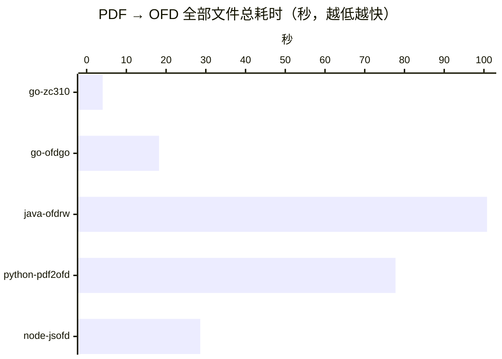

# PDF → OFD 对比测试

> [OFD 库汇总](ofd-libraries.md)：各 OFD 库能力 / 许可证对比表
>
> [OFD → PDF 对比测试](ofd-to-pdf.md)：反方向 OFD→PDF 转换对比


## 测试库

| 转换器         | 语言   | 库                                                                          | 版本                    | 说明                                                                                                         |
|----------------|--------|-----------------------------------------------------------------------------|-------------------------|--------------------------------------------------------------------------------------------------------------|
| go-zc310       | Go     | [zc310/ofd](https://github.com/zc310/ofd)                                   | v0.2.3-0.20261124113956-09f1815cd2bb | 基于 pdfcpu 的 PDF→OFD 导入器（路径/文本/图片/注解/渐变/图案/网格/大纲/元数据），文本保留为可提取 TextObject |
| go-ofdgo       | Go     | [xiaoqidun/ofdgo](https://github.com/xiaoqidun/ofdgo)（ConvertPDF + pdfgo） | v0.0.0-20261124073143-9d9bd2ba2cde | 基于 pdfgo 的 PDF→OFD 导入器（路径/文本/图片/注解）                                                          |
| java-ofdrw     | Java   | [ofdrw](https://github.com/ofdrw/ofdrw)（ofdrw-converter PDFConverter）     | 2.5.2 | 文本转为矢量轮廓                                                                               |
| python-pdf2ofd | Python | [pdf2ofd](https://github.com/wanglrebe/pdf2ofd)                             | 0.1.0                   | 基于 PyMuPDF 渲染，文本栅格化                                                                                |
| node-jsofd     | JS     | [Hufe921/jsOFD](https://github.com/Hufe921/jsOFD)（pdfToOfd + pdfjs-dist）  | 1.0.1                   | 基于 pdfjs 重放绘制指令流（路径/文本/图片），不转换注解/渐变/图案/Type3/剪裁                                 |

> `python-pdf2ofd` 安装：在独立 venv 安装 `python/requirements-pdf2ofd.txt`，通过 `PDF2OFD_PYTHON` 指定该环境的 Python（完整命令见 README）。其 PyMuPDF 1.24.14 与像素评测环境的 1.26.7 隔离。
>
> `node-jsofd` 安装：`npm install @hufe921/jsofd pdfjs-dist`（Node <22 需补 `process.getBuiltinModule`，见 `node/pdf2ofd_jsofd.mjs`）

## 测试文件

直接使用数科版式阅读器导出的参考 PDF（即 OFD→PDF 测试的对比基准），保证与 OFD→PDF 测试同一组文档。

| 文件               | 大小 | 页数    | 说明                                           |
|--------------------|------|---------|------------------------------------------------|
| hello.pdf          | 3.50K | 1 页    | 简单文本                                       |
| ano.pdf            | 904.00K | 3 页    | 发票                                           |
| 999.pdf            | 80.00K  | 5 页    | 简单文档                                       |
| intro.pdf          | 6.70M | 42 页   | 介绍文档                                       |
| zsbk.pdf           | 1.60M | 2 页    | 签章文件                                       |
| 1000-pages.pdf     | 2.40M | 1000 页 | 多页文档                                       |
| GBT_33190-2016.pdf | 4.80M | 132 页  | GB/T 33190-2016 标准正文（字体全内嵌、图表多） |

## 测试环境

<!-- benchmark-environment:start -->

- 系统：Ubuntu 24.04.5 LTS (x86_64)
- CPU：Intel(R) Xeon(R) 6975P-C（4 逻辑核心）
- 内存：15.3 GiB
<!-- benchmark-environment:end -->
- 系统已安装 `apt-get install fonts-wqy-zenhei fonts-noto-cjk`
- 测试前运行 `bash tools/install-fonts.sh`，下载 `doc-foundertype.zip`、`doc-zhongyi-etc.zip`、`latin-fonts.zip` 并安装到用户目录 `~/.local/share/fonts/hanzi-fonts/`，随后刷新字体缓存。字体下载链接与依赖安装命令见 [README：快速开始](../README.md#快速开始)；GitHub Actions 已加入此准备步骤。

> 所有转换器均由 GitHub Actions 在上述环境统一评测。回环统一使用 go-zc310，不改用各库自身回环；转换耗时、文件大小、回环像素及文本比较分别记录。

## 转换速度

图表按库累加下方速度表中全部文件的耗时，单位为秒；耗时为单次测量，多页文件可能主导总耗时。未完成全部文件的库不绘制柱形。

<!-- benchmark-charts:pdf:start -->


<!-- benchmark-charts:pdf:end -->

<!-- benchmark-table:pdf-speed:start -->

| 转换器 | hello.pdf | ano.pdf | 999.pdf | intro.pdf | zsbk.pdf | 1000-pages.pdf | GBT_33190-2016.pdf | 胜出次数 |
|---|---:|---:|---:|---:|---:|---:|---:|---:|
| go-zc310 | **16ms** | **69ms** | **259ms** | **365ms** | 1.12s | **837ms** | **1.38s** | 6 |
| go-ofdgo | 72ms | 7.77s | 312ms | 431ms | 1.69s | 6.05s | 1.90s | 0 |
| java-ofdrw | 905ms | 1.47s | 1.58s | 7.59s | 4.37s | 4.36s | 80.51s | 0 |
| python-pdf2ofd | 120ms | 856ms | 544ms | 2.53s | **974ms** | 53.75s | 18.97s | 1 |
| node-jsofd | 227ms | 438ms | 3.27s | 9.62s | 4.99s | 2.45s | 7.61s | 0 |
<!-- benchmark-table:pdf-speed:end -->

### CPU 总时间

CPU 总时间为进程用户态与内核态时间之和，累加所有线程及已等待回收的子进程；包含启动和包装脚本开销。多核并行时可超过墙钟时间。历史数据未采集此指标，FAILED 表示尚未采集或转换失败，需重新运行基准。

<!-- benchmark-table:pdf-cpu:start -->

| 转换器 | hello.pdf | ano.pdf | 999.pdf | intro.pdf | zsbk.pdf | 1000-pages.pdf | GBT_33190-2016.pdf | 胜出次数 |
|---|---:|---:|---:|---:|---:|---:|---:|---:|
| go-zc310 | **23ms** | **84ms** | **296ms** | **399ms** | 1.20s | **1.04s** | **1.60s** | 6 |
| go-ofdgo | 90ms | 8.00s | 556ms | 1.14s | 2.12s | 10.97s | 5.10s | 0 |
| java-ofdrw | 2.22s | 4.62s | 4.75s | 14.75s | 9.20s | 11.98s | 99.11s | 0 |
| python-pdf2ofd | 120ms | 855ms | 543ms | 2.53s | **973ms** | 53.74s | 18.97s | 1 |
| node-jsofd | 289ms | 773ms | 689ms | 5.74s | 5.14s | 3.93s | 8.55s | 0 |
<!-- benchmark-table:pdf-cpu:end -->

### 进程树内存峰值

Linux 下每 10ms 采样转换进程及其存活子孙进程的 RSS（驻留物理内存）之和，取采样峰值，包含包装脚本和运行时；MB 为 100 万字节。共享内存会重复计数，不等于实际独占物理内存；短于采样间隔的峰值、采样期间退出或脱离进程树的进程可能遗漏，读取受限也可能低估。采样带来少量额外开销。历史数据或未采到有效 RSS 显示为 FAILED，需重新运行基准。

<!-- benchmark-table:pdf-memory:start -->

| 转换器 | hello.pdf | ano.pdf | 999.pdf | intro.pdf | zsbk.pdf | 1000-pages.pdf | GBT_33190-2016.pdf | 胜出次数 |
|---|---:|---:|---:|---:|---:|---:|---:|---:|
| go-zc310 | **34.27MB** | **51.36MB** | 208.86MB | **113.47MB** | 319.61MB | 189.99MB | **145.55MB** | 4 |
| go-ofdgo | 56.10MB | 238.76MB | 191.59MB | 147.19MB | 297.30MB | 1719.03MB | 415.88MB | 0 |
| java-ofdrw | 208.70MB | 460.90MB | 498.24MB | 561.62MB | 565.47MB | 753.74MB | 1697.20MB | 0 |
| python-pdf2ofd | 69.06MB | 99.98MB | **82.22MB** | 171.26MB | **148.69MB** | **94.81MB** | 233.21MB | 3 |
| node-jsofd | 144.44MB | 218.21MB | 193.81MB | 555.91MB | 474.24MB | 652.53MB | 1048.65MB | 0 |
<!-- benchmark-table:pdf-memory:end -->

## OFD 文件大小

<!-- benchmark-table:pdf-ofd-size:start -->

| 转换器 | hello.pdf | ano.pdf | 999.pdf | intro.pdf | zsbk.pdf | 1000-pages.pdf | GBT_33190-2016.pdf | 胜出次数 |
|---|---:|---:|---:|---:|---:|---:|---:|---:|
| go-zc310 | **1.68K** | 405.41K | **62.27K** | **7.33M** | **1.60M** | 4.83M | **7.07M** | 5 |
| go-ofdgo | 5.62K | **393.52K** | 107.44K | 8.80M | 2.68M | 58.63M | 12.99M | 1 |
| java-ofdrw | 5.55K | 601.33K | 817.57K | 34.24M | 20.45M | **3.48M** | 30.54M | 1 |
| python-pdf2ofd | 4.64K | 1.26M | 733.68K | 8.92M | 1.64M | 86.51M | 36.83M | 0 |
| node-jsofd | 2.95K | 2.18M | 590.22K | 34.76M | 12.87M | 31.75M | 34.32M | 0 |
<!-- benchmark-table:pdf-ofd-size:end -->

## 文件大小对比（输出 OFD / 原 PDF）

比值为输出 OFD 字节数除以源 PDF 字节数，`1.00` 表示与源 PDF 等大；**加粗**为最小值。

<!-- benchmark-table:pdf-size-ratio:start -->

| 转换器 | hello.pdf | ano.pdf | 999.pdf | intro.pdf | zsbk.pdf | 1000-pages.pdf | GBT_33190-2016.pdf |
|---|---:|---:|---:|---:|---:|---:|---:|
| go-zc310 | **0.48** | 0.45 | **0.78** | **1.09** | **1.02** | 2.54 | **1.46** |
| go-ofdgo | 1.60 | **0.44** | 1.34 | 1.31 | 1.71 | 30.87 | 2.69 |
| java-ofdrw | 1.58 | 0.67 | 10.23 | 5.10 | 13.00 | **1.83** | 6.32 |
| python-pdf2ofd | 1.32 | 1.43 | 9.18 | 1.33 | 1.04 | 45.55 | 7.62 |
| node-jsofd | 0.84 | 2.47 | 7.38 | 5.18 | 8.18 | 16.72 | 7.10 |
<!-- benchmark-table:pdf-size-ratio:end -->

## 还原度对比

将每个转换器输出的 OFD 再经 go-zc310 转回 PDF（回环），与源 PDF 做像素对比（96 DPI）与文本对比。

像素脚本对 `1000-pages` 仅取前 3 页（仍校验总页数一致）；文本比较仍处理完整文档。所有转换器均使用相同的采样与评测规则。

**像素相似度**（100% 为完全相同）：

<!-- benchmark-table:pdf-pixel-similarity:start -->

| 转换器         |    hello.pdf |      ano.pdf |      999.pdf |     intro.pdf |     zsbk.pdf | 1000-pages.pdf | GBT_33190-2016.pdf | 胜出次数 |
| -------------- | -----------: | -----------: | -----------: | ------------: | -----------: | -------------: | -----------------: | -------: |
| go-zc310       |     99.6300% | **99.7700%** |     98.5700% | **100.0000%** | **99.5600%** |   **99.8400%** |       **99.9800%** |        5 |
| go-ofdgo       |     99.6300% |     98.6200% |     98.4800% |      97.8200% |     99.2500% |       99.6400% |           99.8200% |        0 |
| java-ofdrw     | **99.8500%** |     98.7200% |     98.7500% |      99.5500% |     99.0600% |       97.9900% |           99.6600% |        1 |
| python-pdf2ofd |     99.7200% |     98.3500% | **98.9400%** |      99.3600% |     97.7000% |       98.4000% |             FAILED |        1 |
| node-jsofd     |     99.3700% |     96.7700% |     98.1500% |        FAILED |     98.9100% |       99.5000% |           99.9400% |        0 |
<!-- benchmark-table:pdf-pixel-similarity:end -->

**SSIM 结构相似度**（96 DPI）：与 OFD→PDF 使用相同的 RGB 7×7 均匀窗口 SSIM（样本协方差，`K1=0.01`、`K2=0.03`、`data_range=255`），窗口和通道平均后负分截为 0 并乘 100%，各页等权平均。沿用相同的页面尺寸、缺页和近乎空白输出检查，以及 `intro` 排除页和 `1000-pages` 前 3 页采样规则。新增指标尚无统一重测结果时记 `FAILED`。

<!-- benchmark-table:pdf-ssim:start -->

| 转换器         |    hello.pdf |      ano.pdf |      999.pdf |     intro.pdf |     zsbk.pdf | 1000-pages.pdf | GBT_33190-2016.pdf | 胜出次数 |
| -------------- | -----------: | -----------: | -----------: | ------------: | -----------: | -------------: | -----------------: | -------: |
| go-zc310       |     98.4900% | **96.6400%** |     94.5900% | **100.0000%** | **98.3600%** |   **99.6400%** |       **99.9900%** |        5 |
| go-ofdgo       |     98.4900% |     81.9000% |     93.8300% |      95.1700% |     96.0500% |       99.6300% |           99.7000% |        0 |
| java-ofdrw     |     99.3600% |     90.1100% |     96.0200% |      98.3100% |     96.5800% |       95.4800% |           98.9900% |        0 |
| python-pdf2ofd | **99.4000%** |     90.1900% | **97.9700%** |      97.0900% |     80.0300% |       96.2100% |             FAILED |        2 |
| node-jsofd     |     97.9300% |     89.7600% |     93.2500% |        FAILED |     96.4600% |       99.0100% |           99.9200% |        0 |
<!-- benchmark-table:pdf-ssim:end -->

**提取文本字符数**（从转换后 OFD 提取，参考 PDF 提取字符数见括号）：

<!-- benchmark-table:pdf-text-extraction:start -->

| 转换器 | hello.pdf(22) | ano.pdf(7091) | 999.pdf(3934) | intro.pdf(5543) | zsbk.pdf(1150) | 1000-pages.pdf(263999) | GBT_33190-2016.pdf(107779) |
|---|---:|---:|---:|---:|---:|---:|---:|
| go-zc310 | 22 | 9222 | 9737 | 9314 | 2740 | 326022 | 170697 |
| go-ofdgo | 8 | 12861 | 9781 | 8793 | 3290 | 151998 | 201415 |
| java-ofdrw | 0 | 7049 | 0 | 1598 | 3 | 321998 | 714 |
| python-pdf2ofd | 0 | 0 | 0 | 0 | 0 | 0 | 0 |
| node-jsofd | 25 | 10812 | 9941 | 10222 | 2796 | 326448 | 225807 |
<!-- benchmark-table:pdf-text-extraction:end -->

**文本相似度**（4-gram Jaccard，100% 为与源 PDF 提取文本完全一致）：

<!-- benchmark-table:pdf-text-similarity:start -->

| 转换器         | hello.pdf |  ano.pdf |  999.pdf | intro.pdf | zsbk.pdf | 1000-pages.pdf | GBT_33190-2016.pdf |
| -------------- | --------: | -------: | -------: | --------: | -------: | -------------: | -----------------: |
| go-zc310       | 100.0000% | 33.3300% | 64.4100% |  15.4100% | 10.4300% |       98.5400% |           41.9900% |
| go-ofdgo       |  26.3200% | 51.8500% | 39.0100% |  55.7700% |  8.8600% |        3.9900% |           33.5300% |
| java-ofdrw     |   0.0000% | 64.5900% |  0.0000% |   4.5800% |  0.0000% |       98.8600% |            0.0100% |
| python-pdf2ofd |   0.0000% |  0.0000% |  0.0000% |   0.0000% |  0.0000% |        0.0000% |            0.0000% |
| node-jsofd     | 100.0000% | 36.0800% | 18.2700% |  15.1200% |  6.9400% |       30.2500% |            1.0800% |
<!-- benchmark-table:pdf-text-similarity:end -->


## 复现

```bash
# 编译 zc310 ofd-converter（PDF→OFD / OFD→PDF / OFD→TXT）
cd /home/go/workspace/ofd
go build -o ../ofd-benchmark/bin/ofd-converter ./cmd/ofd-converter

cd ../ofd-benchmark
# 编译基准测试驱动（上级存在 go.work 时需 GOWORK=off）
GOWORK=off go build -o bin/pdf2ofd-benchmark ./cmd/pdf2ofd-benchmark

# 编译 ofdgo PDF→OFD 转换器
GOWORK=off go build -o bin/ofdgo-pdf2ofd ./cmd/ofdgo-pdf2ofd

# 运行全部转换器（单个文件）
./bin/pdf2ofd-benchmark testdata/suwell/hello.pdf

# 批量运行所有测试文件
for f in testdata/suwell/*.pdf testdata/standards/*.pdf; do
  ./bin/pdf2ofd-benchmark "$f"
done

# 还原度/文本对比（输出位于 bin/output_ofd/）
python3 tools/compare_pdf2ofd.py 96
```
